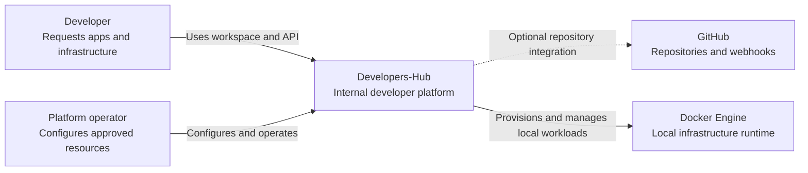
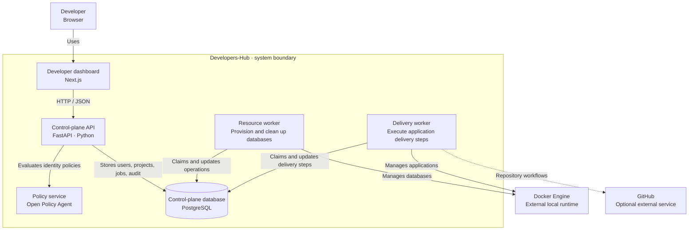
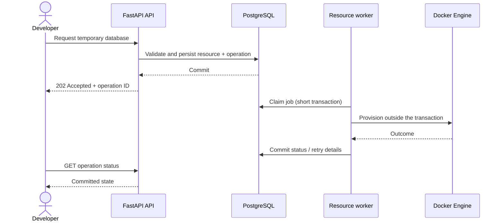

# Developers-Hub

**A self-service internal developer platform for creating applications, provisioning temporary infrastructure, and managing local delivery.**

`Python 3.12` · `FastAPI` · `Next.js` · `PostgreSQL` · `SQLAlchemy` · `Dishka` · `Docker` · `OPA`

[Architecture](#architecture) · [Engineering decisions](#engineering-decisions) · [Run locally](#run-locally) · [Technical deep dive](docs/architecture.md)

## Why I built it

A developer should not need to repeat repository setup, database configuration, access management, and deployment steps for every new project.

**Developers-Hub explores how those tasks can become one reusable developer experience**—while keeping infrastructure operations secure, recoverable, and independent of HTTP request lifetimes.

## What you can do

| Workflow | Capability |
| --- | --- |
| **Create** | Start applications from versioned FastAPI, Node.js, and ASP.NET Core templates; integrate with GitHub when configured. |
| **Provision** | Request approved temporary PostgreSQL databases with quotas, leases, and controlled cleanup. |
| **Deliver** | Manage local Docker application delivery, deployment steps, retries, and optional pull-request previews. |
| **Control access** | Use project roles, browser sessions, API tokens, CSRF protection, and OPA-backed identity authorization. |
| **Track operations** | Review durable resource and delivery status, activity, failures, and retry outcomes in a Next.js workspace. |

## Architecture

### C4 Level 1: System context

*Who uses the platform, and which external systems does it interact with?*



### C4 Level 2: Containers

*The separately running applications and data stores that make up Developers-Hub.*



**Inside the API:** `Identity` owns users, credentials, and sessions; `DeveloperPlatform` owns project access, resources, and delivery. They are **bounded contexts within one modular monolith**, not separate microservices. [Explore the Level 3 component diagram](docs/architecture.md#c4-level-3-control-plane-api-components).

### A provisioning request, end to end



**The principle:** accept work durably, perform external effects outside database transactions, and recover through explicit job state rather than holding an HTTP request open.

## Engineering decisions

| Design choice | Rationale |
| --- | --- |
| **DDD-inspired modular monolith** | Keep domain boundaries clear without paying the operational cost of microservices. |
| **Typed commands, queries, and Dishka DI** | Keep use cases separate from HTTP and infrastructure wiring. |
| **PostgreSQL-backed durable jobs** | Survive retries and worker restarts using claim tokens, leases, idempotency, and recorded outcomes. |
| **Short transaction boundaries** | Commit the intent before provisioning; do not hold locks during Docker or GitHub operations. |
| **Defense-in-depth access** | Project-scoped permissions, HttpOnly sessions, CSRF checks, policy evaluation, and audit events. |

## Run locally

**Requirements:** Docker Engine or Docker Desktop, Docker Compose v2, and Python 3.

```bash
git clone https://github.com/Nicola-Ibrahim/Developers-Hub.git
cd Developers-Hub
./scripts/dev.sh up
```

The script creates local development configuration and starts the **core services**: dashboard, API, PostgreSQL, OPA, and migrations.

- **Dashboard:** <http://127.0.0.1:3000> (includes a synthetic guest preview)
- **API docs:** <http://127.0.0.1:8000/docs>
- **Readiness:** <http://127.0.0.1:8000/health/ready>

> **Development status:** This is an active prototype, not a production deployment. Worker processes and real provisioning require additional operator configuration; the current `main` branch also has outstanding CI failures. The guest preview does not provision real infrastructure. SSE progress streaming and cloud providers are planned work.

To inspect or stop local services:

```bash
./scripts/dev.sh status
./scripts/dev.sh down
```

## Explore the code

| Interested in… | Start here |
| --- | --- |
| Domain boundaries and transaction orchestration | [Architecture deep dive](docs/architecture.md) |
| Authentication, sessions, and authorization | [`backend/src/identity`](backend/src/identity/) |
| Project resources, application delivery, and workers | [`backend/src/devops_platform`](backend/src/devops_platform/) |
| HTTP integration and DI composition | [`backend/src/api`](backend/src/api/) · [`backend/src/composition`](backend/src/composition/) |
| Developer dashboard | [`frontend/src/features`](frontend/src/features/) |
| Infrastructure configuration | [`ops`](ops/) · [Terraform notes](ops/hosting/terraform/README.md) |

**More detail:** [Backend setup](backend/README.md) · [Frontend setup](frontend/README.md) · [C4 component and lifecycle diagrams](docs/architecture.md)
