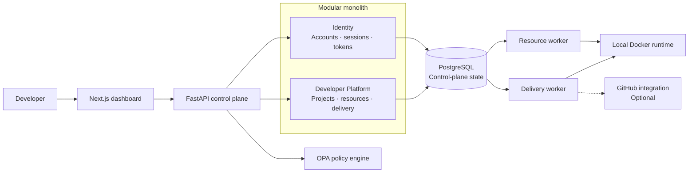
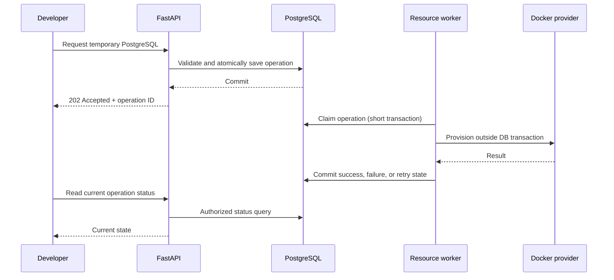

# Developers-Hub

**A self-service internal developer platform for creating, provisioning, and delivering applications.**

Developers-Hub brings common development tasks into one place: start from an approved application template, request a temporary database, and manage local deployments—without rebuilding the same setup for every project.

> **Why I built it:** I wanted to explore how platform engineering can turn repetitive infrastructure and delivery work into safe, repeatable developer workflows. The challenge is not simply starting a container; it is managing access, state, failures, and recovery across the whole operation.

## What it does

| Capability | What the platform provides |
| --- | --- |
| **Developer workspace** | Next.js dashboard for projects, applications, resources, activity, and account sessions. |
| **Identity & access** | Internal accounts, browser sessions, API tokens, project roles, and OPA-backed identity permissions. |
| **Application delivery** | Versioned **FastAPI, Node.js, and ASP.NET Core** starter templates, application registration, local Docker delivery, and optional GitHub/PR-preview integration. |
| **Temporary databases** | Approved PostgreSQL configurations with quotas, time-limited leases, renewal, deletion, and connection details. |
| **Durable operations** | Asynchronous workers with idempotent requests, claims, heartbeats, retries, and recovery after interrupted work. |

## Architecture



**Two bounded contexts** separate authentication and account ownership (**Identity**) from project access, infrastructure resources, and software delivery (**Developer Platform**). Both run in one FastAPI backend, use SQLAlchemy/PostgreSQL for durable state, and communicate through application interfaces and composition-layer integration.

### How a provisioning request works



The **API records intent; workers perform effects**. This keeps HTTP requests short and allows work to recover from retries, worker restarts, or uncertain provider outcomes. Progress is currently available through the operation-status API; SSE streaming is a planned enhancement.

## Engineering decisions

- **DDD-inspired modular monolith:** domain models and application use cases stay separate from FastAPI, SQLAlchemy, and provider adapters.
- **Typed command/query dispatch:** module interfaces route use cases; Dishka resolves dependencies, with action-scoped transactions being adopted incrementally.
- **Durability before side effects:** database acceptance commits before a worker touches Docker or GitHub. Leases, claim tokens, and idempotency protect retries and concurrent execution.
- **Security by boundary:** project-scoped authorization, HttpOnly browser sessions, CSRF checks, OPA identity policies, and audit records.

**Stack:** Python 3.12 · FastAPI · SQLAlchemy 2 · PostgreSQL · Dishka · Alembic · Next.js / React / TypeScript · Docker · OPA · pytest · GitHub Actions · Terraform / Ansible (hosting assets)

## Repository map

```text
backend/src/
  api/               HTTP routes and transport adapters
  identity/          Accounts, authentication, sessions, tokens
  devops_platform/   Projects, resources, application delivery, workers
  composition/       Cross-context wiring and Dishka container
  shared/            Typed dispatch and database infrastructure
frontend/            Next.js developer dashboard
ops/                 Local/hosting automation and monitoring assets
scripts/             Development and database commands
docs/architecture.md Detailed diagrams and boundaries
```

## Explore locally

Requires **Docker Engine/Desktop with Compose v2** and **Python 3**. From the repository root:

```bash
./scripts/dev.sh up      # Initialize local configuration, build, migrate, start core services
./scripts/dev.sh status  # Inspect core services
./scripts/dev.sh down    # Stop local services
```

- **Dashboard:** `http://127.0.0.1:3000` — includes a synthetic guest preview (`/demo`).
- **API docs:** `http://127.0.0.1:8000/docs` · **Readiness:** `/health/ready`.
- The core Compose stack starts PostgreSQL, OPA, the API, migrations, and the dashboard. **Provisioning/delivery workers are separate processes**, and real resource operations require operator configuration and access bootstrap. See [backend setup](backend/README.md) and [frontend setup](frontend/README.md).

## Status & next steps

**Active portfolio / engineering project.** The current provider targets local Docker. Optional GitHub integration is configuration-dependent; production cloud targets and event-driven SSE progress are future work. This repository is not presented as a production-hosted platform.

For a deeper technical walkthrough, see [Architecture](docs/architecture.md), [Backend](backend/README.md), and [Hosting infrastructure](ops/hosting/terraform/README.md).
