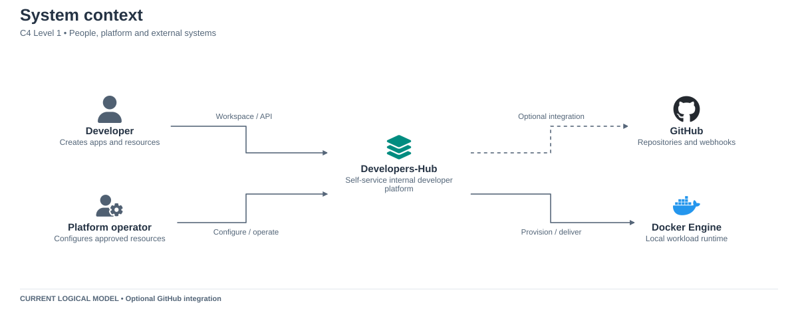
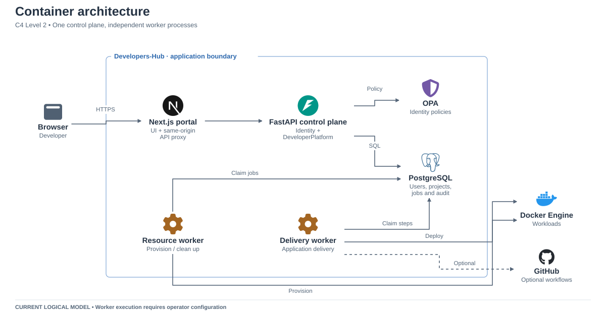
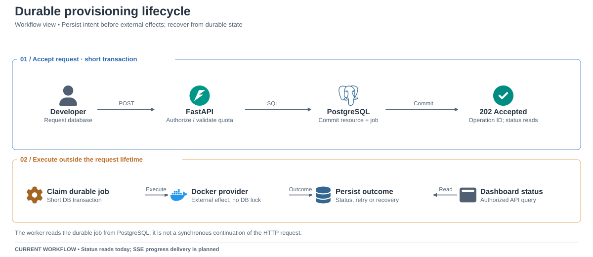

# Developers-Hub

**A self-service internal developer platform for creating applications, provisioning temporary infrastructure, and managing local delivery.**

`Python 3.12` · `FastAPI` · `Next.js` · `PostgreSQL` · `SQLAlchemy` · `Dishka` · `Docker` · `OPA`

[Architecture](#architecture) · [Engineering decisions](#engineering-decisions) · [Run locally](#run-locally) · [Backend](backend/README.md) · [Frontend](frontend/README.md) · [Technical deep dive](docs/architecture.md)

## Why I built it

A developer should not need to repeat repository setup, database configuration, access management, and deployment steps for every new project.

**Developers-Hub explores how those tasks can become one reusable developer experience**—while keeping infrastructure operations secure, recoverable, and independent of HTTP request lifetimes.

## What you can do

| Workflow | Capability |
| --- | --- |
| **Create** | Start applications from versioned FastAPI, Node.js, and ASP.NET Core templates; integrate with GitHub when configured. |
| **Provision** | Request approved temporary PostgreSQL databases with quotas, leases, and controlled cleanup. |
| **Deliver** | Manage local Docker application delivery, deployment steps, retries, and optional pull-request previews. |
| **Control access** | Use project roles, browser sessions, API tokens, CSRF protection, and shared OPA authorization. |
| **Track operations** | Review durable resource and delivery status, activity, failures, and retry outcomes in a Next.js workspace. |

## Architecture

### C4 Level 1 — System context

Who uses the platform and which external systems it interacts with.



[Editable draw.io source](docs/c4/system-context.drawio)

### C4 Level 2 — Containers

The independently running applications and data stores. The frontend and backend have distinct runtime boundaries, but the backend itself remains a modular monolith.



[Editable draw.io source](docs/c4/containers.drawio)

**Inside the API:** `Identity` owns users, credentials, API tokens and sessions; `DeveloperPlatform` owns project access, resources and delivery. They are bounded contexts within one application, not separate microservices. Background workers execute external operations separately and use durable PostgreSQL state.

### Architecture guide

| View | What it explains |
| --- | --- |
| [Backend documentation and diagrams](backend/docs/README.md) | C4 components, provisioning, delivery, and optional server deployment |
| [Frontend documentation and diagrams](frontend/docs/README.md) | C4 components and frontend hosting alternatives |
| [Backend operations](backend/README.md#aws-server-deployment) | Optional Terraform-defined EC2 host; illustrative runtime placement |
| [Image publishing](backend/README.md#image-publishing) | CI, immutable ECR images and the reserved deployment path |
| [Architecture deep dive](docs/architecture.md) | Transaction semantics, source entry points and recovery |

### A provisioning request, end to end



[Editable draw.io source](backend/docs/diagrams/provisioning.drawio)

**The principle:** accept work durably, perform external effects outside database transactions, and recover through explicit job state rather than holding an HTTP request open. Progress is exposed through authorized status reads; SSE is planned.

## Engineering decisions

| Design choice | Rationale |
| --- | --- |
| **DDD-inspired modular monolith** | Keep domain boundaries clear without paying the operational cost of microservices. |
| **Typed commands, queries, and Dishka DI** | Keep use cases separate from HTTP and infrastructure wiring. |
| **PostgreSQL-backed durable jobs** | Survive retries and worker restarts using claim tokens, leases, idempotency, and recorded outcomes. |
| **Short transaction boundaries** | Commit the intent before provisioning; do not hold locks during Docker or GitHub operations. |
| **Defense-in-depth access** | Project-scoped permissions, HttpOnly sessions, CSRF checks, policy evaluation, and audit events. |
| **Independent frontend hosting** | Preserve the server-side API proxy and allow hosting decisions to evolve independently of the backend. |

## Run locally

**Requirements:** Docker Engine or Docker Desktop, Docker Compose v2, and Python 3.

```bash
git clone https://github.com/Nicola-Ibrahim/Developers-Hub.git
cd Developers-Hub
./scripts/dev.sh up
```

The script creates local development configuration and starts the **core services**: dashboard, API, policy service, PostgreSQL and migrations.

- **Dashboard:** <http://127.0.0.1:3000> (includes a synthetic guest preview)
- **API docs:** <http://127.0.0.1:8000/docs>
- **Readiness:** <http://127.0.0.1:8000/health/ready>

> **Development status:** Active prototype, not a production deployment. Workers and real provisioning require operator configuration. The guest preview does not provision infrastructure. SSE progress streaming and cloud providers are planned. The reviewed README reports outstanding CI failures; see [CI](.github/workflows/platform-ci.yml) for checks. AWS hosting definitions are optional, not evidence of a running production environment.

To inspect or stop local services:

```bash
./scripts/dev.sh status
./scripts/dev.sh down
```

## Explore the code

| Interested in… | Start here |
| --- | --- |
| Domain boundaries and transaction orchestration | [Architecture deep dive](docs/architecture.md) |
| Authentication, sessions and authorization | [`backend/src/identity`](backend/src/identity/) |
| Project resources, application delivery and workers | [`backend/src/devops_platform`](backend/src/devops_platform/) |
| HTTP API and backend runtime | [`backend/src/api`](backend/src/api/) · [`backend/src/backend.py`](backend/src/backend.py) |
| Developer dashboard | [`frontend/src/features`](frontend/src/features/) |
| Infrastructure configuration | [`ops`](ops/) · [Terraform notes](ops/hosting/terraform/README.md) |

Cross-system diagrams remain in [`docs/`](docs/README.md). Backend and frontend diagrams are maintained with their component documentation in [`backend/docs/`](backend/docs/README.md) and [`frontend/docs/`](frontend/docs/README.md).
