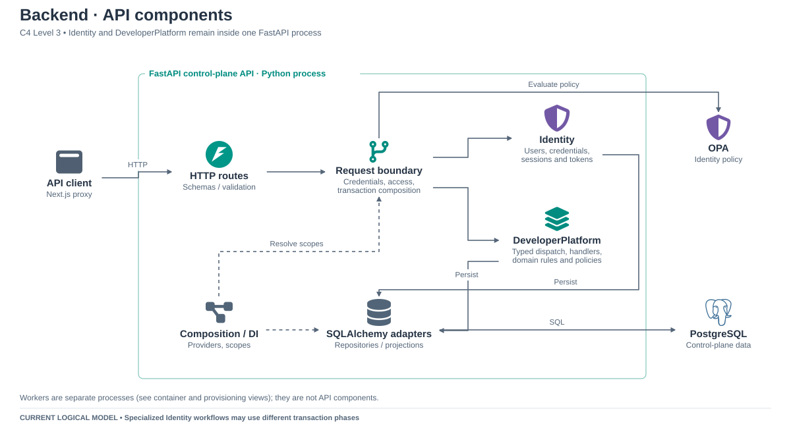
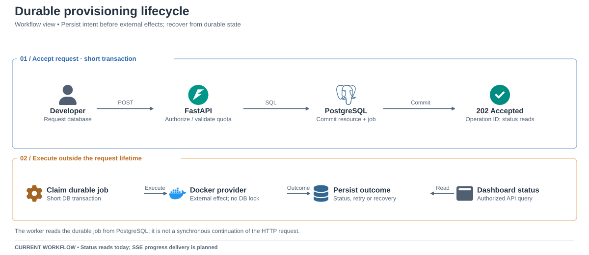
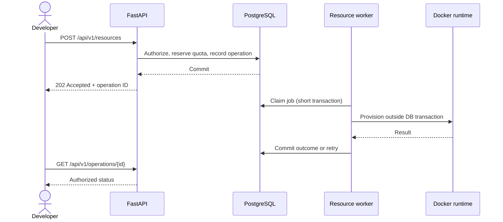
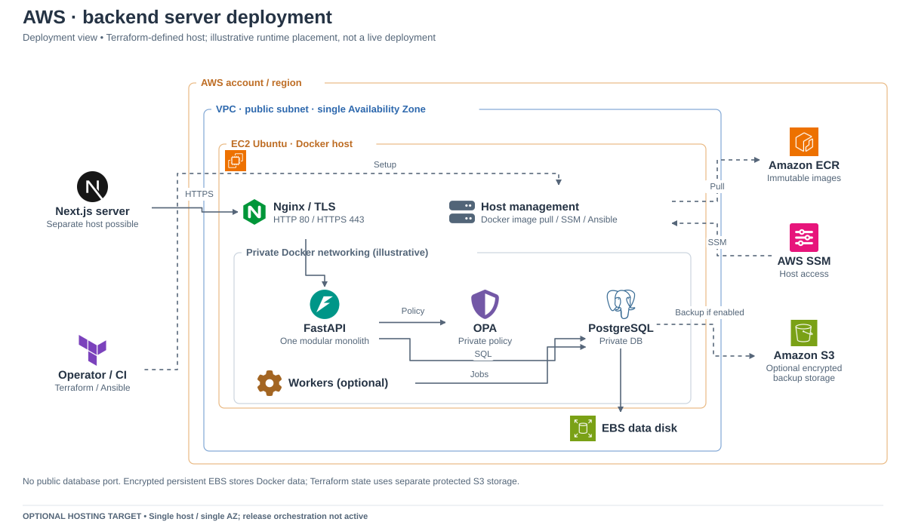
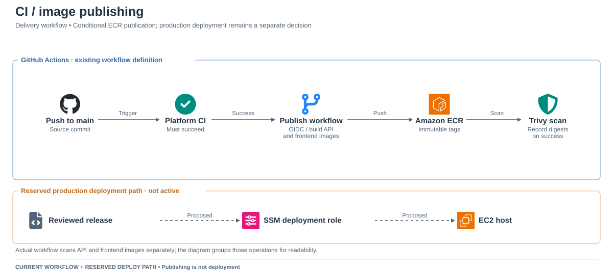

# ⚙️ Developers-Hub Backend

**The control plane behind a self-service internal developer platform.**

`Python 3.12+` · `FastAPI` · `SQLAlchemy 2` · `PostgreSQL` · `Dishka` · `OPA` · `Docker`

[Project overview](../README.md) · [Backend diagrams](docs/README.md) · [System architecture](../docs/architecture.md) · [Frontend](../frontend/README.md)

## What it does

The API turns a developer request into an **authorized, durable operation**. Provisioning is handled by separate workers so HTTP requests do not wait for infrastructure to start.

| Capability | Implementation |
| --- | --- |
| **Identity & access** | Internal users, browser sessions, API tokens, project roles, shared OPA policies |
| **Temporary infrastructure** | Approved PostgreSQL options, quotas, leases, renewal, connection access and deletion |
| **Application delivery** | Versioned FastAPI, Node.js and ASP.NET Core templates, local Docker delivery, optional GitHub previews |
| **Resilience** | Idempotency, durable operations, worker claims, heartbeats, retries and reconciliation |

## Architecture

### C4 Level 3 — API components

The two bounded contexts live in **one modular monolith**, not separate microservices. Resource and delivery workers run as independent processes outside the API process.



[Editable draw.io source](docs/diagrams/backend-components.drawio) · [Container context](../docs/c4/containers.svg)

| Boundary | Responsibility |
| --- | --- |
| Identity | Accounts, credentials, sessions and API tokens |
| DeveloperPlatform | Projects, membership, resource lifecycle, application delivery |
| HTTP API | Request and response mapping through the Identity and DeveloperPlatform modules |
| Backend runtime | Process lifecycle and assembly of context-owned Dishka providers |
| Infrastructure adapters | SQLAlchemy repositories and projections, shared OPA client, runtime providers |
| Workers | Claim durable jobs, perform external effects, persist outcomes |

Each context registers its module commands and queries once. The mediator uses those
bindings to select handlers, and Dishka uses them to construct handlers in the request
or action scope. Container construction checks for missing message registrations, and
the registry rejects duplicate bindings. Routes call `execute()` or `query()` on the modules.

Identity and DeveloperPlatform dispatch protected operations through the policies in
[`ops/policies/`](../ops/policies/). Rego evaluates current actor, project, and ownership
facts supplied by the backend.
The API authenticates sessions and tokens through Identity, including CSRF validation
for cookie-authenticated writes. Platform checks current membership and credential scope
within its transaction. For example, a credential revoked after authentication can still
finish recording a provisioning request if the account and membership remain authorized.

The API and workers run as separate processes. The FastAPI lifespan and worker entry
points start and close `BackendRuntime`. Database, schema, and policy readiness are
checked explicitly.

Local Compose and packaged-stack acceptance mount the same bundle read-only.
`/health/authorization` verifies the shared decision endpoint and policy revision.

**Transaction boundaries:** ordinary Platform operations use a Dishka `ACTION` scope and short SQLAlchemy transaction. Specialized Identity workflows manage multiple phases where needed. External provider calls run **outside** the database transaction. The diagram shows logical components, not one universal handler pipeline.

### Durable provisioning



[Editable draw.io source](docs/diagrams/provisioning.drawio)



The durable operation record makes retries and recovery possible after a crash. **SSE progress streaming is planned**, not implemented in the reviewed code.

## AWS server deployment

The repository includes an optional Terraform target for a single Ubuntu EC2 Docker host in a public subnet. Ansible handles host setup and Nginx/TLS. The diagram illustrates how the backend could be placed there; it is not a deployed runtime contract or a claim of production readiness.



[Editable draw.io source](docs/diagrams/aws-backend.drawio) · [Terraform hosting instructions](../ops/hosting/terraform/README.md)

- One public backend entry point; Identity and DeveloperPlatform remain in the same FastAPI application.
- PostgreSQL and OPA are private to the runtime network. There is no public database ingress.
- Encrypted EBS provides persistent Docker data; optional encrypted backups use S3. Terraform state is stored separately.
- The instance has restricted ECR pull and SSM permissions. Workers require explicit provider configuration; hosting is distinct from per-developer resource provisioning.
- The topology is single-host/single-AZ, not a highly available production system. ECS, ALB, RDS and API Gateway are not part of this Terraform target.

## Image publishing



[Editable draw.io source](docs/diagrams/image-delivery.drawio) · [Publish workflow](../.github/workflows/publish-images.yml)

Successful eligible main-branch CI runs can trigger image publishing when AWS variables are configured. The workflow assumes a restricted GitHub OIDC role, builds and pushes API and frontend images, scans their digests using Trivy, and records release inputs. **Publishing does not deploy.** An SSM deployment role exists in Terraform, but an active production release runner and server deployment contract are not shipped.

## Run locally

**Core stack:** Docker Engine/Desktop, Compose v2 and Python 3. Run from the repository root:

```bash
./scripts/dev.sh up
./scripts/dev.sh status
./scripts/dev.sh down
```

This starts PostgreSQL, OPA, migrations, FastAPI and Next.js. It creates private local environment files if missing. Workers do **not** start with the default Compose stack, and real provisioning remains disabled until an operator configures the provider and project access.

**Backend-only:** Python 3.12+, [`uv`](https://docs.astral.sh/uv/), reachable PostgreSQL and OPA, and configured environment variables (see [`.env.example`](.env.example)). From the repository root:

```bash
cd backend
uv sync --frozen
uv run alembic upgrade head
uv run fastapi dev --host 127.0.0.1 --port 8000
```

Migrations are **explicit**, not part of API startup. Compose-only service names such as `postgres` and `opa` are not reachable from host-native processes without suitable configuration.

**Workers:** run separately with the same configuration and an explicitly enabled provider:

```bash
cd backend
uv run python -m devops_platform.infra.workers.resource_worker
uv run python -m devops_platform.infra.workers.application_worker
```

API documentation: `http://127.0.0.1:8000/docs` · Health: `/health/live`, `/health/ready`, `/health/authorization`.

## Explore the code

| Concern | Entry point |
| --- | --- |
| Platform module and transaction boundary | [`src/devops_platform/infra/module.py`](src/devops_platform/infra/module.py) |
| Typed dispatcher | [`src/shared/dispatch.py`](src/shared/dispatch.py) |
| Domain models | [`src/devops_platform/domain/`](src/devops_platform/domain/) |
| Identity | [`src/identity/`](src/identity/) |
| Backend runtime and DI | [`src/backend.py`](src/backend.py) |
| Resource and delivery workers | [`src/devops_platform/infra/workers/`](src/devops_platform/infra/workers/) |

## Quality checks

From `backend/`:

```bash
uv run --frozen ruff check src migrations tests
uv run --frozen ruff format --check src migrations tests
uv run --frozen mypy src
uv run --frozen pytest -q tests/unit
```

Integration tests additionally require isolated PostgreSQL and, for Docker lifecycle cases, a Docker daemon. See [integration tests](tests/integration/) and [CI](../.github/workflows/platform-ci.yml).

**Security:** HttpOnly browser sessions, CSRF checks, project-scoped authorization and controlled credential exposure. No production secrets belong in Git.

**Project status:** Active engineering prototype. The demonstrated runtime is local Docker; a production cloud provider and SSE progress delivery are not yet shipped.
