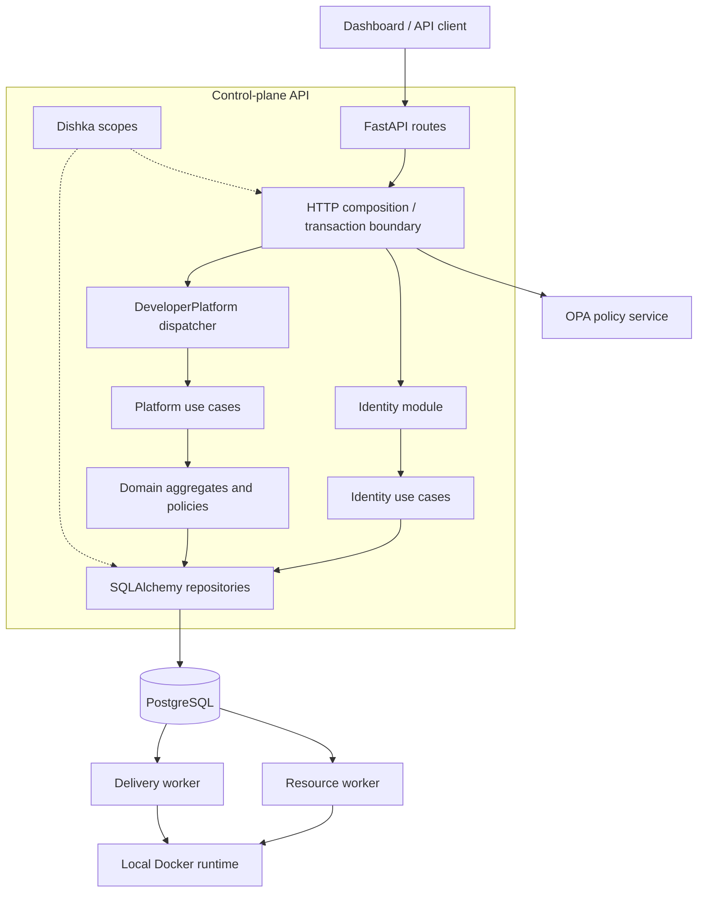
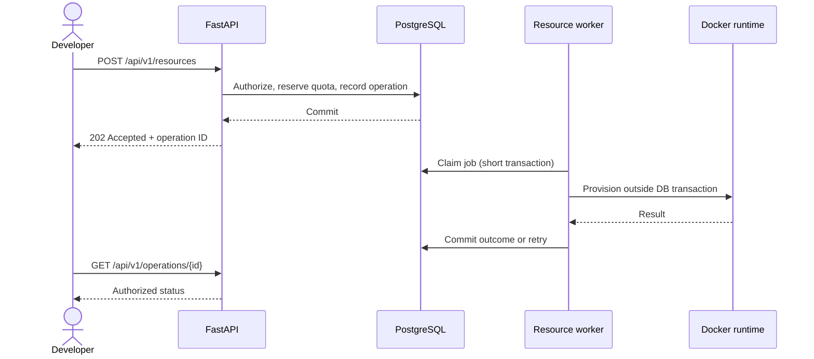

# ⚙️ Developers-Hub Backend

**The control plane behind a self-service internal developer platform.**

`Python 3.12+` · `FastAPI` · `SQLAlchemy 2` · `PostgreSQL` · `Dishka` · `OPA` · `Docker`

[Project overview](../README.md) · [C4 architecture](../docs/architecture.md) · [Frontend](../frontend/README.md)

---

## What it does

The API turns a developer request into an **authorized, durable operation**. Provisioning is handled by separate workers so HTTP requests do not wait for infrastructure to start.

| Capability | Implementation |
| --- | --- |
| **Identity & access** | Internal users, browser sessions, API tokens, project roles, OPA-backed identity policies |
| **Temporary infrastructure** | Approved PostgreSQL options, quotas, leases, renewal, connection access and deletion |
| **Application delivery** | Versioned FastAPI, Node.js and ASP.NET Core templates, local Docker delivery, optional GitHub previews |
| **Resilience** | Idempotency, durable operations, worker claims, heartbeats, retries and reconciliation |

## Architecture

### C4 Level 3 — API components

The two bounded contexts live in **one modular monolith**, not separate microservices. The resource and delivery workers run as independent processes.



**Transaction boundaries:** ordinary Platform operations use a Dishka `ACTION` scope and short SQLAlchemy transaction. Specialized Identity workflows manage multiple phases where needed. External provider calls run **outside** the database transaction.

### Durable provisioning



The worker's durable operation record makes retries and recovery possible after a crash. **SSE progress streaming is planned**, not implemented in the reviewed code.

## Run locally

**Core stack:** Docker Engine/Desktop, Compose v2 and Python 3. Run from the repository root:

```bash
./scripts/dev.sh up
./scripts/dev.sh status
./scripts/dev.sh down
```

This starts PostgreSQL, OPA, migrations, FastAPI and Next.js. It creates private local environment files if missing. Workers do **not** start with the default Compose stack, and real provisioning remains disabled until an operator configures the provider and project access.

**Backend-only:** Python 3.12+, [`uv`](https://docs.astral.sh/uv/), reachable PostgreSQL and OPA, and configured environment variables (see [`.env.example`](.env.example)). From the repository root:

```bash
cd backend
uv sync --frozen
uv run alembic upgrade head
uv run fastapi dev --host 127.0.0.1 --port 8000
```

Migrations are **explicit**, not part of API startup. Compose-only service names such as `postgres` and `opa` are not reachable from host-native processes without suitable configuration.

**Workers:** run separately with the same configuration and an explicitly enabled provider:

```bash
cd backend
uv run python -m devops_platform.infra.workers.resource_worker
uv run python -m devops_platform.infra.workers.application_worker
```

API documentation: `http://127.0.0.1:8000/docs` · Health: `/health/live`, `/health/ready`, `/health/authorization`.

## Explore the code

| Concern | Entry point |
| --- | --- |
| HTTP transaction boundary | [`src/api/platform/module.py`](src/api/platform/module.py) |
| Typed dispatcher | [`src/shared/dispatch.py`](src/shared/dispatch.py) |
| Domain models | [`src/devops_platform/domain/`](src/devops_platform/domain/) |
| Identity | [`src/identity/`](src/identity/) |
| Composition and DI | [`src/composition/container.py`](src/composition/container.py) |
| Resource and delivery workers | [`src/devops_platform/infra/workers/`](src/devops_platform/infra/workers/) |

## Quality checks

From `backend/`:

```bash
uv run --frozen ruff check src migrations tests
uv run --frozen ruff format --check src migrations tests
uv run --frozen mypy src
uv run --frozen pytest -q tests/unit
```

Integration tests additionally require isolated PostgreSQL and, for Docker lifecycle cases, a Docker daemon. See [integration tests](tests/integration/) and [CI](../.github/workflows/platform-ci.yml).

**Security:** HttpOnly browser sessions, CSRF checks, project-scoped authorization and controlled credential exposure. No production secrets belong in Git.

---

**Project status:** Active engineering prototype. The demonstrated runtime is local Docker; a production cloud provider and SSE progress delivery are not yet shipped.
