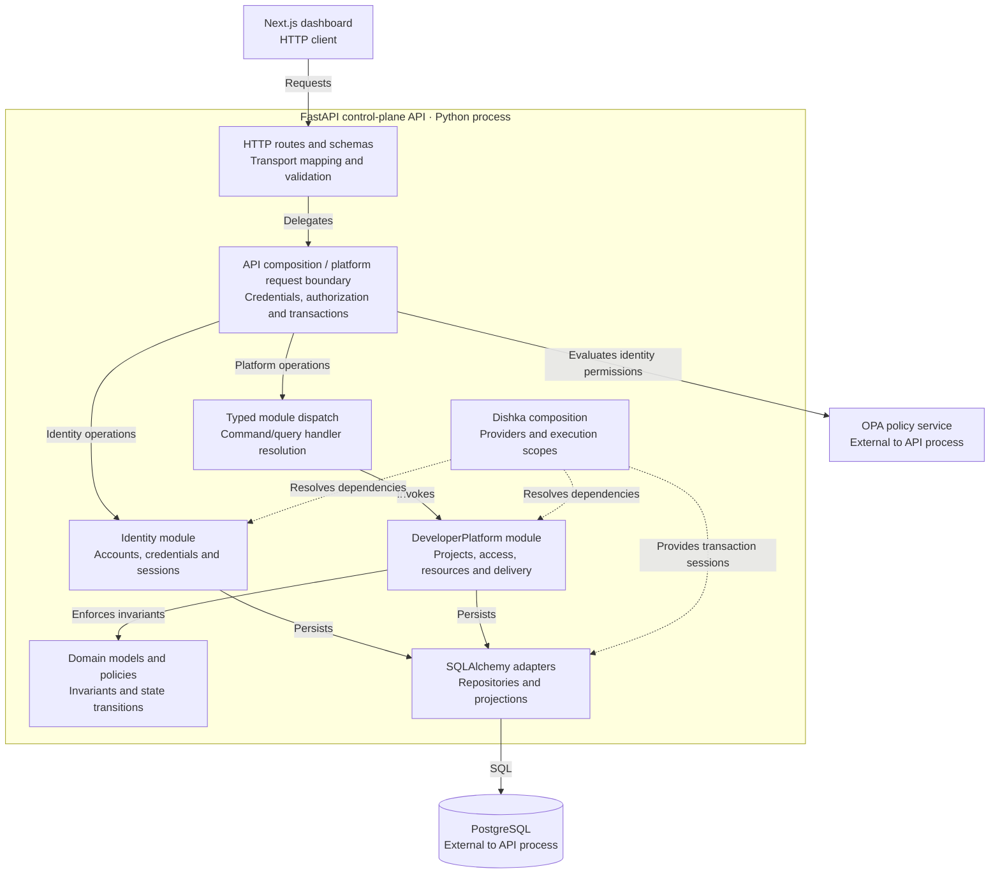
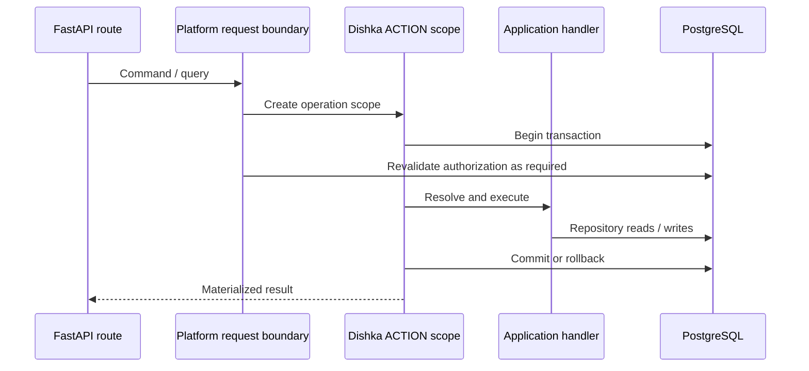
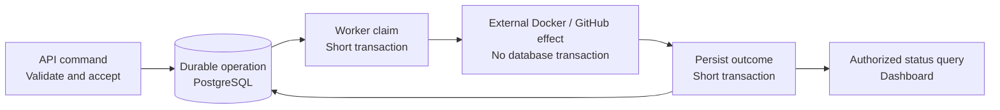

# Developers-Hub · Architecture deep dive

[← Project overview](../README.md)

Developers-Hub is a **DDD-inspired modular monolith** with a FastAPI control-plane API, separately running workers, and a shared PostgreSQL database. Its central concern is the boundary between **transactional control-plane state** and **long-running external effects**.

The [README](../README.md#architecture) contains the **C4 Level 1 system context** and **Level 2 container** diagrams. This document zooms into the API application (Level 3), then shows its database/worker lifecycle.

## C4 Level 3: Control-plane API components

*Components inside the FastAPI application container (not individually deployed services).*

The diagram shows logical components and dependencies; it is **not a claim that every use case currently follows an identical dispatcher pipeline**. Platform HTTP operations use Dishka `ACTION` scopes; some Identity workflows retain specialized transaction handling.

## Bounded-context responsibilities

| Context | Owns | In the code |
| --- | --- | --- |
| **Identity** | Users, credentials, API tokens, browser sessions, authentication and session security | [`backend/src/identity/`](../backend/src/identity/) |
| **DeveloperPlatform** | Projects, project membership and authorization, resource admission/leases, operations, application delivery | [`backend/src/devops_platform/`](../backend/src/devops_platform/) |
| **Composition** | HTTP adaptation, cross-context integration, Dishka registration, transaction boundary assembly | [`backend/src/api/`](../backend/src/api/) and [`backend/src/composition/`](../backend/src/composition/) |

The two contexts share a PostgreSQL control-plane database. Their separation is primarily **code, ownership, and domain behavior**, not separate databases or deployments.

## Transaction model

### Ordinary API operations

The module boundary owns the **normal atomic platform operation**, while SQLAlchemy supplies the actual database transaction. A request may contain multiple separate operations; an HTTP connection is **not** automatically one long transaction.

### Multi-phase work

Login, credential-file delivery, and infrastructure workers can require specialized boundaries. A successful first phase cannot be undone by rolling back a later phase, so these workflows rely on explicit state, idempotency, and compensating or recovery operations where applicable.

## Durable provisioning and application delivery

- **Resource worker:** creates, reconciles, renews, and removes approved local PostgreSQL resources.
- **Delivery worker:** processes application delivery steps and supports retries and optional GitHub-backed workflows.
- **Recovery:** durable job status, leases, claim tokens, retries, and provider-outcome reconciliation protect against interrupted operations.

**Current behavior:** operation progress is exposed through ordinary API reads. An SSE-based push channel is part of the intended evolution, **not an implemented capability in the reviewed revision**. Worker retry/recovery scheduling remains distinct from frontend progress delivery.

## Runtime and operational boundaries

- **API and dashboard:** core Compose services for local development.
- **Workers:** independent processes, not automatically started by the core Compose stack.
- **PostgreSQL:** source of truth for control-plane resources, identities, and operation state; schema managed explicitly by Alembic.
- **OPA:** policy decisions for identity authorization; project-specific authorization also lives in the platform application.
- **Docker:** implemented local runtime provider; cloud provider support remains future work.
- **Terraform and Ansible:** supporting hosting/bootstrap infrastructure in [`ops/`](../ops/), not proof of an automated production deployment.

## Key source entry points

| Concern | Source |
| --- | --- |
| API assembly and routes | [`backend/src/api/`](../backend/src/api/) |
| Typed dispatch registry | [`backend/src/shared/dispatch.py`](../backend/src/shared/dispatch.py) |
| Platform HTTP transaction boundary | [`backend/src/api/platform/module.py`](../backend/src/api/platform/module.py) |
| Identity module dispatch | [`backend/src/identity/infra/composition/module.py`](../backend/src/identity/infra/composition/module.py) |
| Platform per-operation DI | [`backend/src/devops_platform/infra/composition/providers_action.py`](../backend/src/devops_platform/infra/composition/providers_action.py) |
| Resource worker | [`backend/src/devops_platform/infra/workers/resource_worker.py`](../backend/src/devops_platform/infra/workers/resource_worker.py) |
| Application delivery worker | [`backend/src/devops_platform/infra/workers/application_host.py`](../backend/src/devops_platform/infra/workers/application_host.py) |

*Diagrams document the architecture visible in the current repository; they do not constitute integration or production-readiness certification.*
