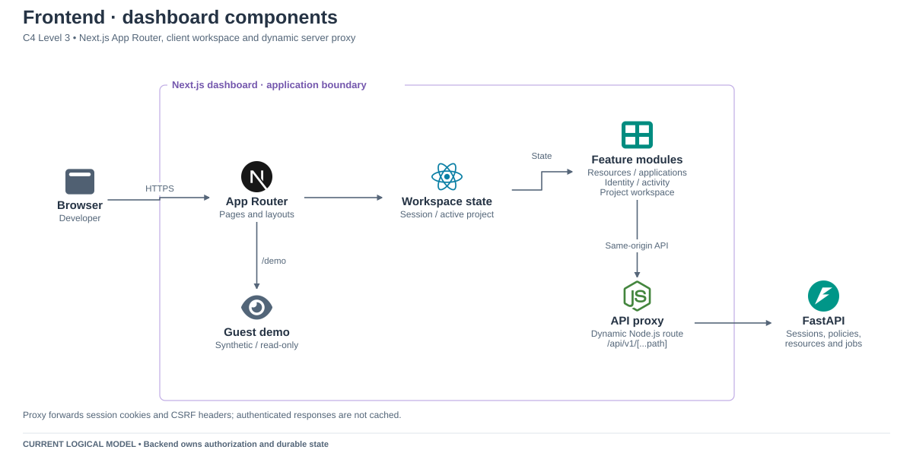
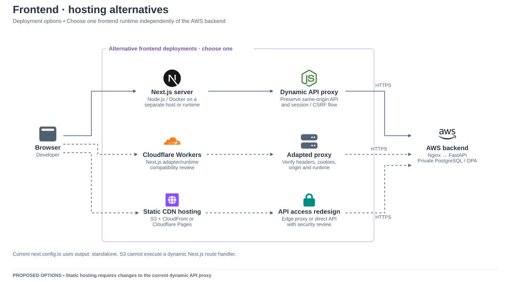

# 🖥️ Developers-Hub Dashboard

**A single workspace for developers to manage projects, applications and temporary infrastructure.**

`Next.js 16` · `React 19` · `TypeScript` · `App Router` · `CSS`

[Project overview](../README.md) · [Frontend diagrams](docs/README.md) · [Backend API](../backend/README.md) · [System architecture](../docs/architecture.md)

## What developers see

| Workspace | Capability |
| --- | --- |
| **Overview** | Active project and workspace summary |
| **Resources** | Request databases, inspect status, extend leases, reveal connections and delete |
| **Applications** | Create applications, manage previews, attach databases and deploy approved images |
| **Account & team** | Sign in, change passwords, manage sessions and authorized project memberships |
| **Activity** | Project-scoped operation history |
| **Guest demo** | Synthetic, read-only workspace at `/demo` — no backend access required |

## Frontend architecture

### C4 Level 3 — Dashboard components

The browser accesses FastAPI through a **same-origin Next.js API proxy**. Next.js owns presentation and session-aware navigation; FastAPI owns authorization and infrastructure state.



[Editable draw.io source](docs/diagrams/frontend-components.drawio)

### Key UI boundaries

- **Identity:** the server manages an HttpOnly session cookie; browser mutations use an in-memory CSRF token.
- **Project switching:** the workspace provider resets or rejects stale state after user/project changes.
- **Secrets:** resource connection credentials are requested only when the user opens the connection view.
- **Permissions:** the UI reflects allowed operations but never replaces backend authorization checks.
- **Progress:** current resource/application views use periodic status refreshes. **SSE-only progress is planned**, not implemented.

### Server-side API proxy

The dynamic `src/app/api/v1/[...path]/route.ts` route runs in Node.js. It uses a server-only `BACKEND_URL`, checks allowed methods, validates origins for mutations, requires a CSRF header except for login, forwards selected headers/cookies, and propagates upstream responses without caching authenticated data. The backend remains responsible for validating sessions and permissions.

## Frontend hosting

The frontend can be deployed separately from the FastAPI backend. The existing Dockerfile builds a Next.js standalone Node.js runtime, not a static site.



[Editable draw.io source](docs/diagrams/frontend-hosting.drawio) · [Backend hosting](../backend/README.md#aws-server-deployment)

| Option | Fit for current code |
| --- | --- |
| **Next.js standalone server** | Closest fit. Deploy as a separate Node.js process/container, on AWS or another host. Configure HTTPS, backend connectivity and trusted origins. |
| **Cloudflare Workers** | Proposed. Verify Next.js adapter/runtime support, dynamic proxy, cookie forwarding, request origin and streaming behavior before adopting. |
| **S3 + CloudFront** | Proposed static option. S3 cannot execute the dynamic Next.js proxy; requires static export compatibility and an API/authentication redesign. |
| **Cloudflare Pages (static)** | Same constraint as static S3 hosting; requires refactoring or an appropriate separate server/edge proxy. |

Choose one frontend deployment, not all of them. No alternative is claimed to be live. Keep browser-facing authentication, CSRF and backend access boundaries under review when changing hosts. The proxy currently uses a 30-second upstream timeout; future SSE would require separate streaming design and testing.

## Run locally

Requires Node.js 22+, npm and a reachable backend. From `frontend/`:

```bash
npm ci
BACKEND_URL=http://127.0.0.1:8000 npm run dev
```

Open `http://127.0.0.1:3000`. `BACKEND_URL` is server-side only; use `http://api:8000` inside Docker Compose (see [`.env.example`](.env.example)). Configure the backend's allowed browser origins for authenticated mutations.

To run the complete core stack from the repository root, use:

```bash
./scripts/dev.sh up
```

The demo is available without an account. Actual infrastructure actions require an operator-created account, authorized project and enabled provider.

## Code map

| Concern | Location |
| --- | --- |
| Routes, layouts and page boundaries | [`src/app/`](src/app/) |
| Active session and project | [`src/features/workspace/`](src/features/workspace/) |
| Resource lifecycle UI | [`src/features/resources/`](src/features/resources/) |
| Application and deployment UI | [`src/features/applications/`](src/features/applications/) |
| Sign-in and administration | [`src/features/identity/`](src/features/identity/) |
| API proxy | [`src/app/api/v1/`](src/app/api/v1/) |
| Shared styles | [`src/app/globals.css`](src/app/globals.css) |

## Verify

```bash
npm run typecheck
npm run build
node --test tests/client.test.mjs
```

**Known issue recorded in the existing README:** components import `src/lib/api/client` and `src/lib/api/pagination`, but those shared modules were missing from the reviewed tree. Restore or verify them before expecting the TypeScript check or build to pass.

For server-side contracts, security and provisioning workflows, see the [Backend README](../backend/README.md).
