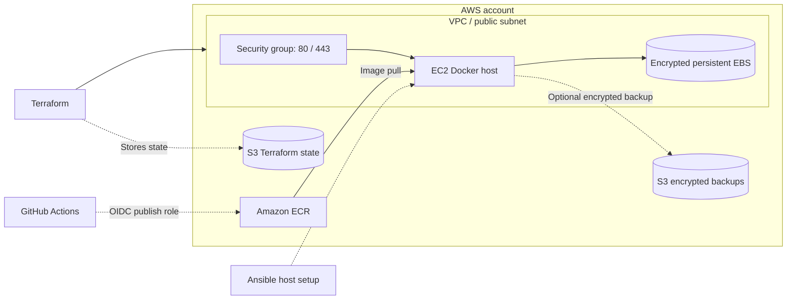

# ☁️ Developers-Hub AWS Hosting

**Optional Terraform infrastructure for a Docker-based platform host.**

`Terraform 1.10+` · `AWS` · `EC2` · `EBS` · `ECR` · `S3` · `IAM / OIDC`

[Project overview](../../../README.md) · [C4 architecture](../../../docs/architecture.md) · [Backend](../../../backend/README.md)

---

## Scope

This Terraform configuration describes an **optional AWS hosting target**. It is not required for the local demonstration and does not constitute an automated production deployment.

| Infrastructure | Responsibility |
| --- | --- |
| **VPC and security group** | HTTP/HTTPS ingress; optional CIDR-restricted SSH; no public PostgreSQL port |
| **EC2 and EBS** | Docker host with encrypted root disk and a separate persistent data disk |
| **ECR** | Container image repository with immutable tags |
| **IAM and GitHub OIDC** | Separate, restricted image publishing and deployment identities |
| **S3** | Protected Terraform state and optional encrypted backups |
| **Ansible** | Separate host setup, Nginx/TLS and optional backup scheduling |

## Infrastructure architecture



**Separation of responsibilities:** Terraform provisions infrastructure, Ansible configures the host, and platform workers manage developer resources. The deployment IAM role is provisioned, but no automatic production release runner is currently active.

## Plan the infrastructure

**Prerequisites:** Terraform 1.10+, appropriately scoped AWS access, and a reviewed cost estimate. Run commands from this README's directory.

### 1. Create protected Terraform state storage

```bash
cd state-bootstrap
terraform init
terraform plan -var='state_bucket_name=your-globally-unique-bucket'
```

Review and explicitly approve the plan before applying. Preserve the bootstrap's local Terraform state in an approved secure location. The S3 state bucket uses encryption, versioning, public-access blocking and `prevent_destroy`.

### 2. Prepare the hosting configuration

```bash
cd ../aws-platform
cp backend.hcl.example backend.hcl
cp terraform.tfvars.example private.tfvars
# Supply the state bucket, exact GitHub repository, and verified OIDC thumbprint.
terraform init -backend-config=backend.hcl
terraform fmt -check -recursive
terraform validate
terraform plan -var-file=private.tfvars
```

**Before running `apply`:** verify region, instance and storage cost, GitHub OIDC trust, SSH CIDRs and the persistent data-volume plan. Do not commit state, credentials, real private variables or locally configured backend files.

## Operational safeguards

| Area | Guardrail |
| --- | --- |
| **Data** | Separate encrypted EBS data volume; explicit initialization of a blank device; destruction protection |
| **Network** | No database ingress from the public Internet; SSH disabled unless CIDRs are set |
| **Permissions** | Narrow instance privileges and separate GitHub publish/deploy roles |
| **Recovery** | State versioning, retained snapshots and optional encrypted backup workflow |
| **Teardown** | Deliberate backup, resource cleanup and review of any destructive plan |

The EBS data volume is **not formatted automatically**. Its initializer requires an explicit, reviewed action. Terraform also does not manage the lifecycle of individual developer database containers.

## Relevant files

| Area | Path |
| --- | --- |
| S3 state bootstrap | [`state-bootstrap/`](state-bootstrap/) |
| AWS host and IAM resources | [`aws-platform/`](aws-platform/) |
| Platform host setup | [Ansible playbook](../ansible/playbooks/setup.yml) |
| Backup and restore utilities | [`../scripts/`](../scripts/) |

---

**Status:** Hosting infrastructure code is present, but this repository does not claim an active public deployment or automated production release process.
